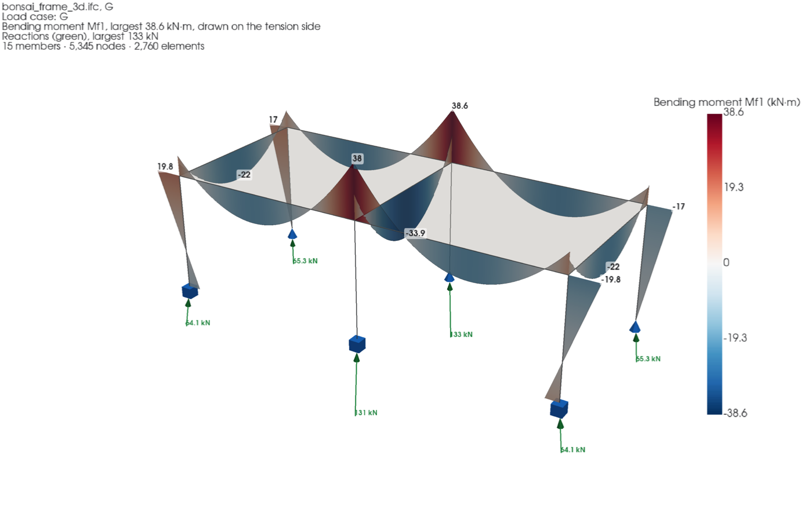
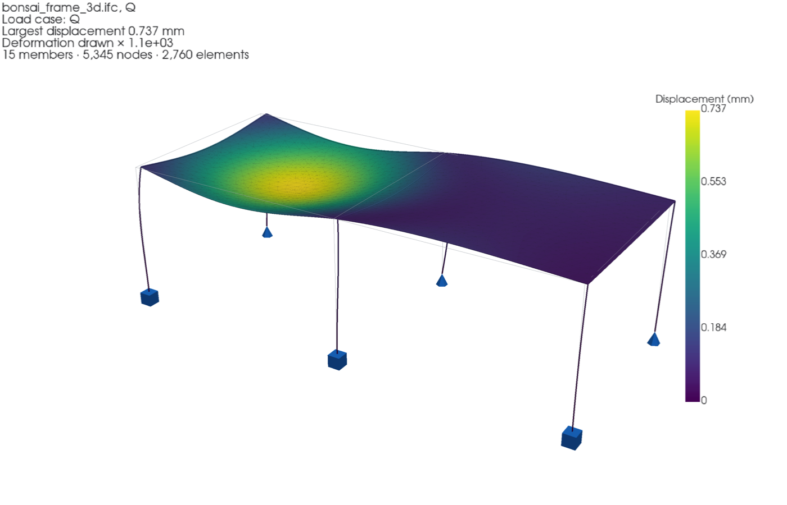
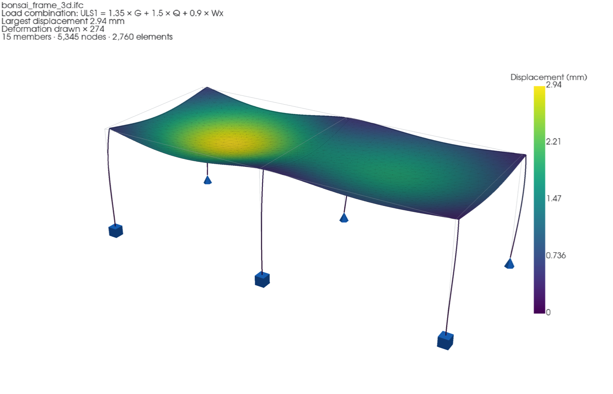
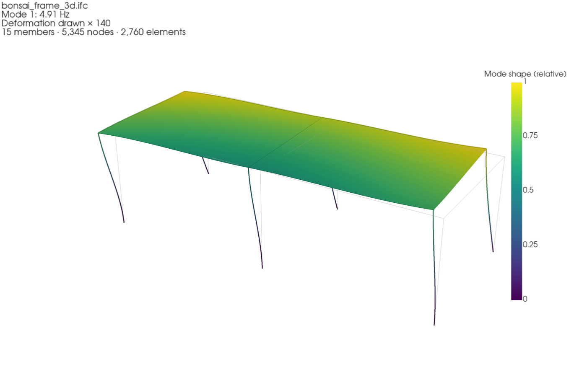
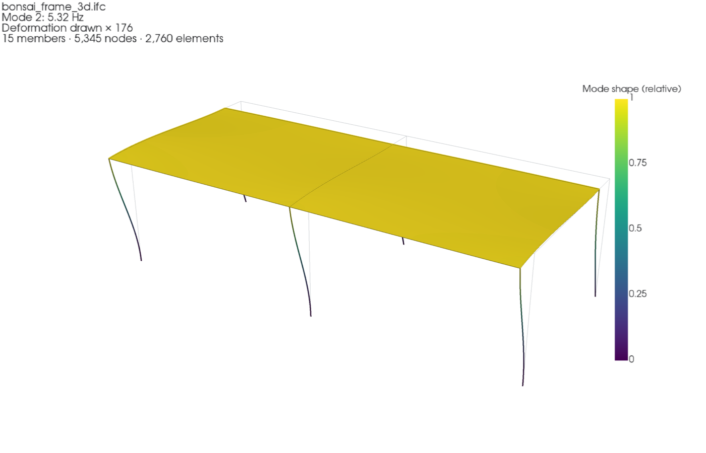

# A test model made in Bonsai

How to build, by hand in Bonsai, a small 3D model that uses the structural
features Bonsai has, that `ifc-analysis` can analyse, and that can be entered
in another analysis program (Code_Aster, OpenSees, SAP2000, Robot, RFEM...) to
compare the results.

`bonsai_frame_3d.ifc` in this folder is the model built by hand in Bonsai from
this guide (2026-11-15), with the workarounds of steps 6 and 7.

The model is chosen so that the comparison is fair:

- **Solid rectangular concrete sections.** This library models a rectangle
  exactly, torsion included; an I-section becomes an equivalent rectangle
  whose torsion is far too stiff (`docs/design/sections.md`), and its U1
  alternative cannot be used with shells.
- **Beams, slab and column tops in one plane** (z = 3.5 m): no offsets, no
  rigid end zones, no T-beam action, which programs model in different ways.
- **Joints and supports that every program has**: shared nodes, fixed and
  pinned bases.

## The model

Two bays in x, one in y, one storey. Units: m, kN.

```
 y
 5  C4 o-------B3-------o C5 -------B4-------o C6     pinned bases
    |                   |                    |
   B5       S1         B6        S2         B7       slab 0.2 m on top
    |                   |                    |
 0  C1 o-------B1-------o C2 -------B2-------o C3     fixed bases
    0                   6                   12  x
```

| Items | IFC class | Template | Geometry | Section |
|---|---|---|---|---|
| K1 to K6 | `IfcStructuralCurveMember` (RIGID_JOINED_MEMBER) | EDGE | columns from z = 0 to 3.5 under C1 to C6 | 0.4 × 0.4 |
| B1 to B4 | `IfcStructuralCurveMember` | EDGE | x-direction beams, 6 m, z = 3.5 | 0.3 wide × 0.5 deep |
| B5 to B7 | `IfcStructuralCurveMember` | EDGE | y-direction beams, 5 m, z = 3.5 | 0.3 wide × 0.5 deep |
| S1, S2 | `IfcStructuralSurfaceMember` (SHELL) | FACE | 6 × 5 m panels, z = 3.5 | 0.2 thick |
| C1 to C6 | `IfcStructuralPointConnection` | VERTEX | column tops | |
| F1 to F6 | `IfcStructuralPointConnection` | VERTEX | column bases | |
| L1 to L7 | `IfcStructuralCurveConnection` | EDGE | along B1 to B7 | |

Material `C30/37` for everything: E = 33 GPa, ν = 0.2, density 2500 kg/m³
(this library takes g = 9.81 m/s²; set the other program to the same).

Section properties, for the other program:

| Section | A (m²) | I strong (m⁴) | I weak (m⁴) | J (m⁴) |
|---|---|---|---|---|
| 0.4 × 0.4 | 0.16 | 2.1333e-3 | 2.1333e-3 | 3.5988e-3 |
| 0.3 × 0.5 | 0.15 | 3.1250e-3 | 1.1250e-3 | 2.8163e-3 |

Shear deformation is included here (Timoshenko beams, thick shells); switch it
on in the other program too.

## Building it in Bonsai

1. **Project.** New metric project. With #10219 it declares kN-based
   structural units; check Project Setup > Units for force, moment, linear and
   planar force units.
2. **Analysis model.** Structural tab > Structural Analysis Models > Add; make
   it current, so new items and load cases go into it.
3. **Material.** Add `C30/37` with `Pset_MaterialMechanical`
   (`YoungModulus`, `PoissonRatio`, `MassDensity`). Nothing is assumed: a
   material without them is an error.
4. **Profiles.** In the Profiles tab of the scene properties, add two
   `IfcRectangleProfileDef`: `R400x400` (XDim 400, YDim 400 in a millimetre project) and `R300x500`
   (XDim 300, YDim 500; YDim is the depth, along the member's local z).
5. **Members.** Add Element for each row of the table, snapping to exact
   coordinates. A curve member's section is a material **profile set**, not a
   plain material: in the member's Material panel choose Profile Set and add
   it, then in its Material Profiles box pick the profile and `C30/37` and
   press + (one item). A curve member with only a material, or with a profile
   set that has no profile in it, is refused. Give S1 and S2 the plain
   material `C30/37` and set their `Thickness` attribute (the Structural Member
   panel shows "Thickness: Unset" until you do).
6. **Axes.** `Axis` is mandatory on curve members and curve connections, and
   Bonsai does not yet set it when it creates them (`94g.34.48`): without it
   the file fails validation, and this library guesses the orientation with a
   warning. On every column, beam and L1 to L7, press Edit Axis and then the
   tick, even at 0°. At 0° a horizontal beam's local z is vertical (depth
   vertical), which is what is wanted; a beam lying flat bends 2.8 times as
   much. The columns are square, so their angle does not matter.
7. **Joints.** On each connection, add a relation to **every** member that
   meets there (Structural Connection > pick member > +):
   - C1 to C6: the column, the beams ending there, and the slab panel(s) whose
     corner it is (C2 and C5 have both panels);
   - F1 to F6: the column;
   - L1 to L7: the beam and the panel(s) along it (L6 has both). This makes
     beam and slab share nodes all along the beam, as other programs do.
     Without the curve connections this library still ties beams to the slab,
     but as a hinge line (`W-JNT-001`), which other programs do not do.

   Do not press the pencil beside a member in this list: it is for a release,
   and its Cancel button stays greyed out (`94g.34.47`), so the member cannot
   be removed either. To get out, run this in Blender's Python console with
   the connection selected:
   `C.object.BIMStructuralProperties.active_connects_structural_member = 0`.
   Bonsai does not check that a member touches the connection: check the
   list before going on.
8. **Supports.** F1 to F3: all six degrees of freedom fixed. F4 to F6:
   displacements fixed, rotations free. Set every value; one left unset is
   refused (`E-SUP-007`).
9. **Load cases**, each with a load group. All loads in global axes:
   - `G` (PERMANENT_G): self-weight only. Tick self-weight, then Reset
     Self-Weight Downwards for coefficients (0, 0, -1).
   - `Q` (VARIABLE_Q): select S1 only, Apply Structural Load, -3 kN/m² in z.
     Loading one bay gives an unsymmetrical result, which finds more faults.
   - `Wx` (VARIABLE_Q): select K1 and K4, 2 kN/m in +x.
   - `Wy` (VARIABLE_Q): select C1, C2 and C3, a point force of 10 kN in +y
     each.

   Show Loads in the 3D view and check every arrow.
10. **Combinations** (#10225), assigned to the analysis model:
    - `ULS1` (Purpose ULS): G 1.35, Q 1.5, Wx 0.9
    - `ULS2` (Purpose ULS): G 1.35, Q 1.05, Wy 1.5
    - `SLS` (Purpose SLS): G 1.0, Q 1.0
11. **Save** as `bonsai_frame_3d.ifc`.

## Analysis

```bash
ifc-analysis analyze bonsai_frame_3d.ifc --output ./out --mesh-size 0.25 --verbose
ifc-analysis analyze bonsai_frame_3d.ifc --output ./out-modal --analysis-type modal --modes 6
ifc-analysis plot ./out --combination ULS1 --edges
ifc-analysis plot ./out --field Mf1 --loads --reactions
```

A 0.25 m mesh divides every length, so the points below are nodes. Read every
warning in `out/results.json` and look its code up in `docs/messages.md`; a
model built as above should need none about joints or supports.

### Checks by hand

| Case | Sum of reactions |
|---|---|
| G | 520.2 kN up (slab 294.3, beams 143.5, columns 82.4; beams and slab overlap and are both counted in full, as in other programs) |
| Q | 90.0 kN up |
| Wx | 14.0 kN in -x |
| Wy | 30.0 kN in -y |

`imbalance_N` and `moment_imbalance_Nm` should be near zero in every case,
and each combination should equal its cases times their factors.

### What to compare with the other program

- Reactions (three forces, three moments) at F1 to F6, per load case.
- Displacements at the middle of S1 (3, 2.5, 3.5), the middle of S2
  (9, 2.5, 3.5) and the top of K6 (12, 5, 3.5):
  `python -m ccxquery out/analysis.inp nodes-at 3 2.5 3.5`, then
  `python -m ccxquery out/analysis.frd node <id>`.
- Bending moments in B6 at its ends and middle, from `results.json`.
- The first three natural frequencies from the modal run (mass of the
  materials only; do not let the other program add mass from loads).

Reactions and frame moments should agree to about 1%, slab deflections to a
few percent, since shell elements differ between programs. A larger
difference is worth a bead. Once a result is agreed, add the model to
`tests/test_data/` and its reference values to
`tests/validation/test_pipeline_benchmarks.py`.

## Appendix: results of this library

`bonsai_frame_3d.ifc` at commit `e0e65da` (sha256 `94294cd1…`), analysed
with ifc_structural_mechanics 0.2.0 and CalculiX 2.23 on a 0.25 m mesh of
quadratic elements (B32R beams, S6 shells): 5,345 nodes, 2,760 elements.
The pictures are made by `python docs/images/make_images.py bonsai_frame_3d`.

The only warning is `W-SEC-001`: the torsional stiffness of a solid
rectangle is approximate, by up to 9 %. Bending is not affected. The modal
run adds `W-LOD-011` (the load cases add no mass, as asked above) and
`W-LOD-006` (no combinations in a modal analysis).

Units below: kN, kN·m, mm. Forces and displacements are in global axes.

### Sums of reactions

| Case | Fx | Fy | Fz | Hand check | Imbalance (N / N·m) |
|---|---|---|---|---|---|
| G | 0 | 0 | 520.18 | 520.2 up | 0.06 / 0.22 |
| Q | 0 | 0 | 90.00 | 90.0 up | 0.00 / 0.01 |
| Wx | −14.00 | 0 | 0 | 14.0 in −x | 0.00 / 0.01 |
| Wy | 0 | −30.00 | 0 | 30.0 in −y | 0.00 / 0.01 |
| ULS1 | −12.60 | 0 | 837.24 | 1.35 G + 1.5 Q + 0.9 Wx | 0.08 / 0.30 |
| ULS2 | 0 | −45.00 | 796.74 | 1.35 G + 1.05 Q + 1.5 Wy | 0.08 / 0.29 |
| SLS | 0 | 0 | 610.18 | G + Q | 0.06 / 0.22 |

### Reactions at the bases

Fx, Fy, Fz in kN; Mx, My, Mz in kN·m. F4 to F6 are pinned and carry no
moment.

| Base | Case | Fx | Fy | Fz | Mx | My | Mz |
|---|---|---|---|---|---|---|---|
| F1 | G | 8.38 | 4.69 | 63.42 | −2.49 | 9.55 | −0.02 |
| F2 | G | 0.00 | 9.56 | 130.64 | −8.03 | 0.00 | 0.00 |
| F3 | G | −8.38 | 4.69 | 63.42 | −2.49 | −9.55 | 0.02 |
| F4 | G | 4.85 | −5.41 | 64.90 | | | |
| F5 | G | 0.00 | −8.13 | 132.89 | | | |
| F6 | G | −4.85 | −5.41 | 64.90 | | | |
| F1 | Q | 3.99 | 2.16 | 20.69 | −1.18 | 3.91 | 0.11 |
| F2 | Q | −4.39 | 2.56 | 25.33 | −2.21 | −5.66 | 0.12 |
| F3 | Q | 0.14 | 0.01 | −1.67 | 0.13 | −0.47 | 0.11 |
| F4 | Q | 2.44 | −2.46 | 21.41 | | | |
| F5 | Q | −2.38 | −2.13 | 25.85 | | | |
| F6 | Q | 0.21 | −0.14 | −1.60 | | | |
| F1 | Wx | −5.61 | −0.72 | −0.79 | 1.42 | −5.91 | 0.11 |
| F2 | Wx | −2.01 | −0.01 | −0.29 | 0.01 | −3.74 | 0.12 |
| F3 | Wx | −1.68 | 0.74 | 1.08 | −1.44 | −3.36 | 0.12 |
| F4 | Wx | −3.50 | −0.20 | 0.19 | | | |
| F5 | Wx | −0.67 | 0.01 | −0.43 | | | |
| F6 | Wx | −0.54 | 0.19 | 0.24 | | | |
| F1 | Wy | −0.12 | −7.62 | −3.73 | 15.16 | −0.13 | 0.01 |
| F2 | Wy | 0.00 | −8.03 | −4.36 | 15.63 | 0.00 | 0.00 |
| F3 | Wy | 0.12 | −7.62 | −3.73 | 15.16 | 0.13 | −0.01 |
| F4 | Wy | 0.06 | −2.21 | 3.76 | | | |
| F5 | Wy | 0.00 | −2.31 | 4.30 | | | |
| F6 | Wy | −0.06 | −2.21 | 3.76 | | | |

G is symmetric about x = 6 m, as it should be. Under G the frame also leans
in y (Fy at every base, 0.25 mm at the top): the fixed bases on y = 0 are
stiffer than the pinned ones on y = 5. Under Q the far corners F3 and F6
lift by 1.6 to 1.7 kN.



### Displacements

At the input node nearest each point (the slab is meshed in triangles, so
the nearest node is up to 3 cm away), as the mean over the cross-section:
ux, uy, uz in mm.

| Point | G | Q | Wx | Wy |
|---|---|---|---|---|
| S1 middle (3, 2.5, 3.5) | 0.00, 0.25, −1.33 | 0.08, 0.09, −0.73 | 0.15, 0.03, 0.00 | 0.00, 0.56, −0.03 |
| S2 middle (9, 2.5, 3.5) | 0.00, 0.25, −1.33 | 0.08, 0.04, 0.04 | 0.15, −0.03, 0.01 | 0.00, 0.56, −0.03 |
| K6 top (12, 5, 3.5) | 0.00, 0.25, −0.05 | 0.10, 0.01, 0.00 | 0.17, −0.05, 0.00 | 0.00, 0.56, 0.00 |

| Point | ULS1 | ULS2 | SLS |
|---|---|---|---|
| S1 middle | 0.25, 0.49, −2.89 | 0.08, 1.27, −2.61 | 0.08, 0.34, −2.06 |
| S2 middle | 0.25, 0.37, −1.74 | 0.08, 1.22, −1.80 | 0.08, 0.29, −1.30 |
| K6 top | 0.30, 0.31, −0.07 | 0.10, 1.19, −0.08 | 0.10, 0.26, −0.05 |

The largest displacements are 1.36 mm (G), 0.74 mm (Q), 2.94 mm (ULS1) and
2.90 mm (ULS2; 3.35 mm here until 2026-11-27, when the code of 0.3.0 gave the
reactions, the moments in B6, the frequencies and the other largest displacements
of this appendix unchanged).





### Bending moments in B6

Mf1 (about the beam's horizontal axis, kN·m, positive hogging) from
`results.json`. B6 runs from C2 (y = 0) to C5 (y = 5). The beam shares its
nodes with both slab panels, so its moment jumps a little at each node where
the slab takes force from it (`docs/design/known_limitations.md`); the values
are at its ends and at the node in the middle.

| Case | C2 end | Middle | C5 end |
|---|---|---|---|
| G | 17.46 | −33.92 | 19.62 |
| Q | 4.29 | −8.87 | 4.78 |
| Wx | −0.03 | 0.04 | −0.03 |
| Wy | −8.58 | −0.97 | 5.56 |
| ULS1 | 29.97 | −59.07 | 33.63 |
| ULS2 | 15.20 | −56.57 | 39.85 |
| SLS | 21.74 | −42.79 | 24.40 |

How much of the slab works with the beam differs between programs, so these
are the results to compare with most care.

### Natural frequencies

Mass of the materials only: 53.0 t (520.18 kN / 9.81).

| Mode | Hz | Effective mass | Shape |
|---|---|---|---|
| 1 | 4.91 | 82 % in x | sway in x, twisting: the pinned side y = 5 moves more |
| 2 | 5.32 | 95 % in y | sway in y |
| 3 | 7.34 | 13 % in x | twist about z |
| 4 | 15.65 | 0 % | |
| 5 | 16.95 | 66 % in z | slabs vertical |
| 6 | 25.84 | 0 % | |




